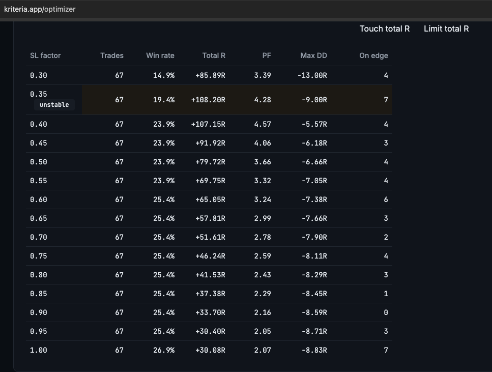
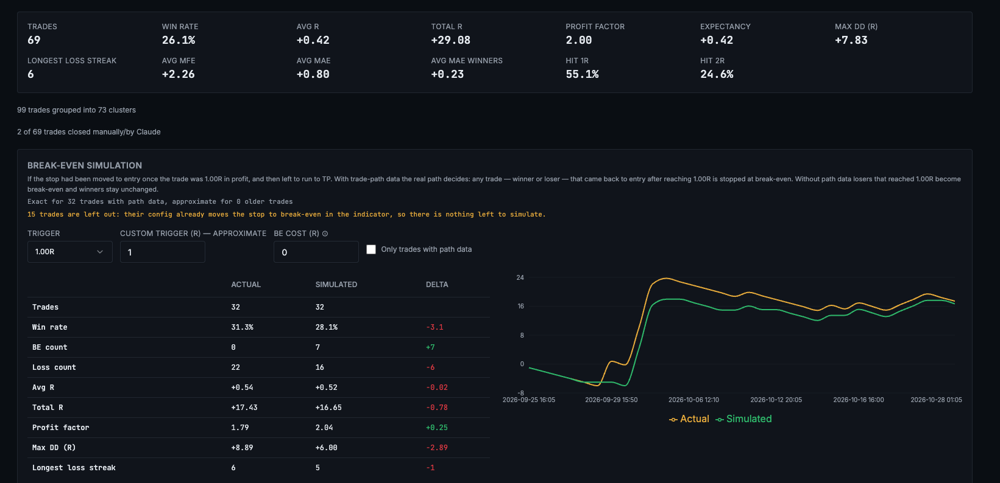
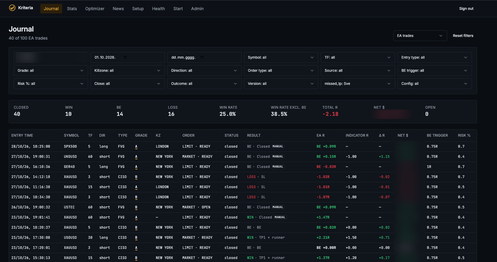

# Kriteria — trading journal and analytics platform

**Live:** [kriteria.app](https://kriteria.app)

A multi-user platform that turns raw TradingView alerts into measured trading performance. Built because every journal I tried either required manual entry, ignored how the trade actually behaved between entry and exit, or couldn't tell me which of my own configurations was responsible for a result.

> **Source code is private.** The trading logic is the product. This repository documents the architecture, the data model and the design decisions. Code available on request or under NDA.

---

## The problem

A discretionary intraday trader running one strategy across several symbols, timeframes and parameter sets accumulates a specific kind of debt: hundreds of trades, each tagged with a configuration, and no reliable way to attribute outcome to setting.

Manual journalling fails at this. It is slow, it is entered after the fact, and it records what the trader remembers rather than what happened. It cannot answer the questions that matter:

- Which configuration is actually carrying the results, and which is noise?
- How far did price run in my favour before I was stopped out?
- If I had managed stops differently, would the outcome have been better — measurably, not in hindsight?
- Where in the setup funnel are trades being lost?

Kriteria answers these from data the trading platform already emits.

---

## How it works

```
TradingView indicator
        │  alert fires on entry, modification and close
        ▼
  Per-user webhook endpoint
        │  JSON payload: symbol, timeframe, direction, entry type,
        │  grade, killzone, config id, indicator version, R values
        ▼
   Ingestion + validation
        │  trades reconstructed from paired open/close events
        │  incomplete trades tracked separately, never silently dropped
        ▼
      PostgreSQL
        │
        ├──► Journal     complete trade log, 15+ filter dimensions
        ├──► Stats       R distributions, MFE/MAE, funnels, clustering
        ├──► Optimizer   parameter sweeps over the full trade set
        ├──► News        scheduled calendar + live headline feed
        └──► Telegram    notifications and owner-locked trade controls
```

Every user gets their own webhook URL and sees only their own data. Accounts are approved manually — this is a controlled rollout, not an open sign-up.

---

## Modules

### Journal

The complete trade log. Every trade carries its originating configuration, so any view can be sliced by it.

Filters: account, date range, symbol, timeframe, entry type, grade, killzone, direction, order type, source, break-even trigger, risk %, close reason, outcome, indicator version, config.

Trades executed by the EA are tracked separately from manual and indicator-only trades, with **EA R** and **Indicator R** shown side by side and the delta between them made explicit. That delta is the honest measure of execution quality: it isolates slippage and fill differences from strategy performance.

### Stats

Aggregate performance with the metrics that actually discriminate between a working system and a lucky one.

Trade count · win rate · average R · total R · profit factor · expectancy · max drawdown in R · longest loss streak · average MFE · average MAE · average MAE on winners · hit rate at 1R and 2R.

Trades are clustered so that multiple entries on the same setup are not counted as independent samples — a distinction that materially changes win rate and expectancy on a strategy that scales into positions.

### Optimizer

Sweeps a parameter across the full historical trade set and reports the outcome at each value: trade count, win rate, total R, profit factor, max drawdown, and a count of trades sitting on the decision boundary.

The boundary count is the point. A parameter value that produces excellent returns while many trades sit within a rounding error of a different outcome is **flagged as unstable** rather than reported as optimal. The module is built to resist overfitting, not to find the highest number.

### Break-even simulation

Replays historical trades against alternative stop-management rules. Where recorded trade-path data exists, the real price path decides the counterfactual outcome — a trade that reached the trigger and later returned to entry is stopped at break-even, exactly as it would have been live.

Results are presented as actual versus simulated across win rate, R, profit factor, drawdown and loss streak, with both equity curves overlaid. Trades whose configuration already moves the stop are excluded from the simulation rather than double-counted.

This is the module I'm least willing to compromise on. Stop-management questions are where discretionary traders lose the most money to untested intuition.

### News

Scheduled high-impact economic calendar combined with a live headline feed. Polling is killzone-aware — frequent during active sessions, relaxed outside them. Used for trade tagging, filtering and pre-session briefings.

### Health

Ingestion monitoring. Surfaces missed alerts, unpaired events and trades left open, so gaps in the data are visible rather than quietly corrupting the statistics.

---

## Stack

| Layer | Technology |
|---|---|
| Frontend | React · TypeScript · Tailwind |
| Backend | Supabase · PostgreSQL · Edge functions |
| Ingestion | Webhook endpoints, per-user routing |
| Signal source | TradingView (Pine Script v6) |
| Execution | MetaTrader 5 Expert Advisor |
| Notifications | Telegram Bot API |
| Build | Lovable · Claude Code · JetBrains |
| Hosting | Custom domain, managed deployment |

---

## Design decisions worth explaining

**No external price feed.** Statistics are computed entirely from alert payloads emitted by the indicator. This keeps the system self-contained, removes a dependency and a cost, and guarantees the analytics describe exactly what the strategy saw — not what a third-party feed thought happened.

**Incomplete trades are tracked, not dropped.** An open trade with no close event is a data quality signal. Hiding it inflates the statistics; surfacing it tells the user something is wrong with their alert configuration.

**Multi-user from day one.** Per-user webhooks, per-user Telegram bots, row-level isolation. Retrofitting multi-tenancy onto a single-user tool is painful; the schema assumed it from the first migration.

**Break-even band on EA results.** Fills within a small tolerance of entry are classified as break-even rather than marginal wins or losses, while the true R is still recorded and fed into the equity curve. Execution noise should not masquerade as edge.

**Configuration is a first-class dimension.** Every trade carries the config that produced it and the indicator version that was running. Without this, comparing settings across time is meaningless.

---

## Status

In production and in active daily use. Running a controlled rollout to a small group of experienced traders, each on their own account and alert configuration.

---

## Screenshots

### Optimizer — stop-loss parameter sweep



Each stop-loss factor is replayed across the full trade set. The `unstable` flag marks parameter regions where many trades sit on the decision boundary — the value that looks best is not always the one to trust.

### Stats — aggregate performance and break-even simulation



R-multiple distributions, MFE/MAE, profit factor, expectancy and hit rates, with the break-even simulator comparing actual against simulated outcomes on recorded trade paths.

### Journal — trade log and filtering



Every trade carries its originating configuration. EA fills are shown next to what the indicator intended, with the delta made explicit. Monetary figures are redacted.
---

*Built and maintained by [Ivan Šimić](https://www.linkedin.com/in/ivan-simic/).*
